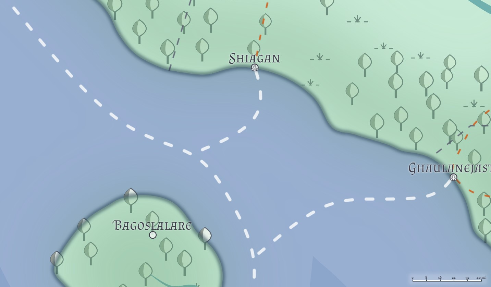
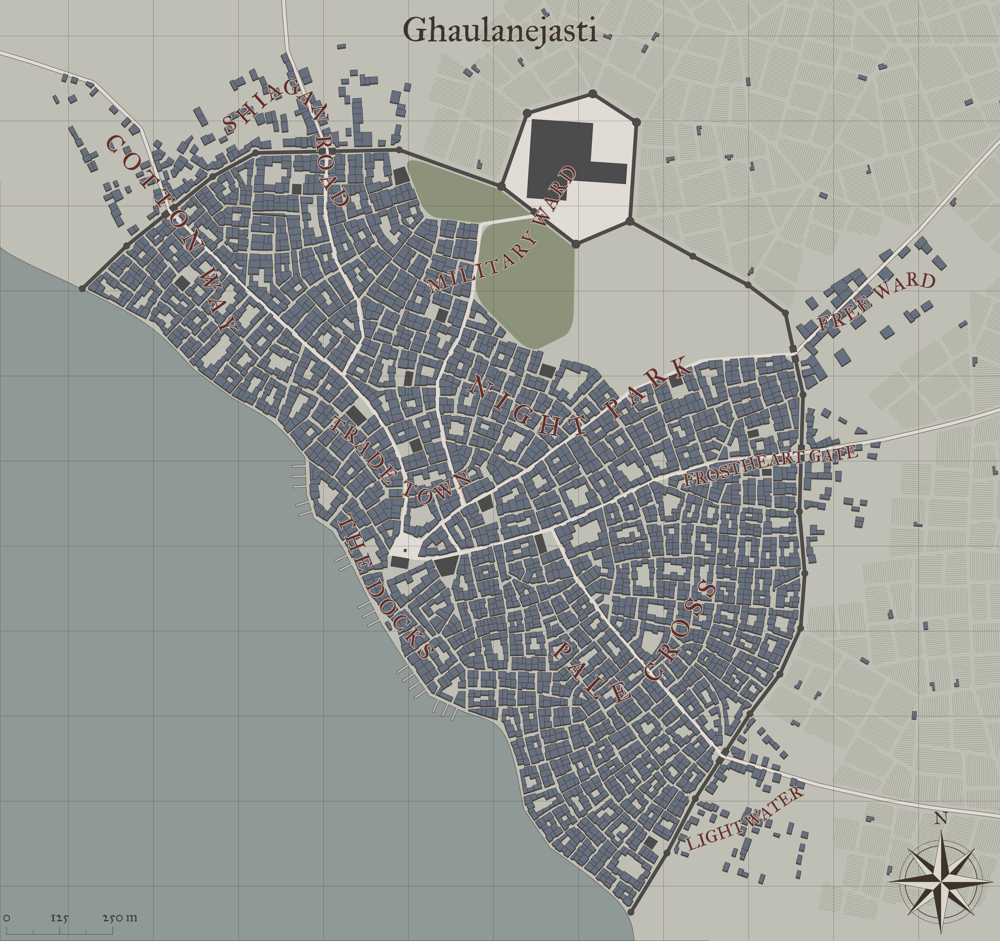

# Ghaulanejasti
*(Merdenbia, [Yithi](../Nations/Yithi.md))*

**Population:** 70,000  *(Humans: 20,000 | Firstborn: 10,000 | Created: 10,000 | Hordish: 30,000)*

Ghaulanejasti is the central port of the Slalare Sea, as its relative shelter from Zabalasan maritime raids over the centuries has preserved it from the repeated destruction frequently visited upon the other cities along Yithi's coastline along the Bloodwaters. The city itself is a thriving, bustling city, easily boasting a much larger population count than its census would suggest, owing to all the visitors and passing-thru merchants. The high concentration of military units here helps keep the city from becoming too lawless, although as with any city this size a criminal element is easily found.

## Geography
**Coordinates:** Latitude: -7.86, Longitude: 32.81

**Elevation:** 59

The Ghaulanejasti-[Shiagan](./Shiagan.md) Road runs through the North Gate of the city, and is all but abandoned, due to the frequent bandits that trapped all traffic on the northern (Shiagan-side) part of that road. As a result, the Ghaulan Guard presence here is lax and often lazy.

The Draga Road, however, which runs from [Dragazakama](./Dragazakama.md) to [Overoslugry](./Overoslugry.md) and from there up to the intersection with the Yithi Road, enters the city through the Lightwater Gate, and exits again through the Freeward Gate.

The Frost Heart road, meanwhile, serves as a major thoroughfare for foot traffic to the town of Halar, which rests at the mouth of the Halararvar River and handles much of the maritime traffic from the Bay of Ghaulan (most of which is trying to avoid [Overoslugry](./Overoslugry.md)). As a result, the eastern and southeastern portions of the city are much more active with foot and cart traffic, while the northern and northwestern sections of the city tend to be quieter, less prone to visitor traffic, and less flush with cash.

### Surrounding area

### City Layout

**Citadel.** Ghaulanejasti retains a citadel for the upper ranks and guests, and the Jasti Guard resides there. In addition, much of the Ghaulan Guard resides within the Military Ward when they are not out on patrol, and the green fields in the Ward are often the site of practice drills and exercises.

**City Walls.** The walls are in good shape, kept in good order by the city authorities.

#### The Docks
Ghaulanejasti boasts a thriving port for maritime shipping and military vessels. Yithi naval units often station here for overhauls or long-term maintenance work, meaning the city often has a higher-than-normal concentration of sailors and formal military units than most other cities.

Just landward in The Docks district lies the Fish Market (also sometimes called Fishmarket Plaza by outsiders), a large plaza that has been the heart of the city since its founding. It is the city's main market square, and boasts every sort of shop, booth, or merchant selling mundane goods that one might imagine. Around the edges of the plaza are dozens of inns and taverns, catering primarily to the city's maritime traffic. Even during the deepest parts of the night, the Fishmarket is often abuzz with revelers and impromptu social gatherings, as various enterprising entrepreneurs use the merchant stalls at night to run games of chance, under the watchful eyes of the Ghaulan Guard. Punishments for common thievery are stiff, and the Ghaulan Guard maintain a constant high presence. As a result, the Fishmarket is both "always open" and surprisingly safe to visit.

#### Trade Town District
As its name implies, this is where most merchant offices and warehouses are located, which is not surprising given its relative location to The Docks. What might be surprising is that this district is also the bustling center of the commoners' parts of the city, with many inns, taverns, apartments, houses, and even small stables here. It is routinely patrolled by squads of the Ghaulan Guard, and the streets are clean, bereft of litter, and wide enough to permit cart traffic down most avenues.

#### Frost Heart District
This is the "upper class" district, with less activity within its own streets but also benefitting from frequent Ghaulan Guard patrols. Inns are less frequent here but of higher cost and class, and taverns here are quiet rather than boisterous. Many Guildmasters maintain their private residences here. Many of the divine buildings, most notably the Church to Kaevar, are located here.

#### Night Park District

#### Pale Cross District
This is the "other" merchant district, boasting many warehouses. However, this is also where many of the dueling colleges, bardic schools, and mage towers have chosen to establish themselves, and as such it boasts the highest concentration of living space (inns, homes, apartments, and so on). The Ghaulan Guard patrol through here periodically, but the high presence of so many "specialists" often acts as its own discouragement to crime.

#### Military Ward
Within this district lies much of the mercenary and military housing and barracks. Patrols here are light.

#### Lightwater District
This is one of several places within Ghaulanejasti that might qualify as a "shantytown", although frequent visitation by various charitable groups keep it from growing too far out of control.

#### Freeward District
Similar to the Lightwater district, the Freeward district is home to many of the city's less fortunate.

#### Cotton Way District
The Cotton Way district is by far the worst of the city's slums, and the Cotton Way Gate has been said to have been closed for so long that city officials can't even be sure it would open again. Neither the Ghaulan Guard nor the Jasti Guard will patrol here except in large numbers. The district gets its name from the many sheep fields that used to be just outside the gates along this road, but the fields fell into disuse centuries ago when a plague took most of the city's flocks, and the slums sprung up shortly thereafter.

#### Shiagan Road District
The Shiagan Road district is, like the neighboring Cotton Way district, a slum. However, the Shiagan Road gate opens during the day and closes at night, and the small amount of foot traffic in and out of the city along the Shiagan Road means Guard patrols here are more frequent than in the Cotton Way. Beggars litter the road and will often pester travelers, though if the Guard spot them they will quickly scurry away.

## Great Houses
Technically, Yithi has no connections to any of the Great Houses. In practice, however, many of the Great Houses maintain a presence in the city in the furtherance of House designs.

[House Kaal](../Organizations/Houses/Kaal.md) has an office here, led by [[NPC: ]], who is content to merely observe and report the various goings-on within the city.

[House Jarmaath](../Organizations/Houses/Jarmaath.md) also has an office here, headed by **TODO**, who is openly seeking to improve relations between Liria and Yithi. Unfortunately, House agents are often 

## Military Units
**Marines.** These are typically rotated between port guard duty, tariff duty in incoming vessels, and extended patrols out into the waters around Ghaulanejasti. The Yithi Navy typically retains a "brigade" of Yithi Marines here, totaling around 500 under the command of a ranked Captain.

**Palace Guard.** Known as the Jasti Guard, these typically rotate between citidel guard duty and special missions as dictated by city authorities. 75xFighter 3-5, 20xWizard/Sorcerer 3-5, 30xCleric/Druid 3-5, 25xRogue 3-5.

**City Guard.** The City Guard is known as the Ghaulan Guard, and is approximately 750 strong on a given day.

**Militia.** Mustered on demand. 2550xFighter1, 1050xFighter2, 420xFighter3, 168xFighter4, 42xFighter5 (Total: ~4230)

## Militant Orders
The Kaevarian Templar maintain a chapterhouse here, frequently recruiting new initiates from the Faithful. 

The **[Knights of Dread](/Organizations/MilitantOrders/DreadKnights.md)** maintain a Dreadhouse here. Though they do not have any open connection to the city's leadership, it is an open secret among the populace and the Jasti and Ghaulan Guards. No one is quite sure why the city (or the Prince) tolerate their presence. However, more than once a thief or burglar has been unceremoniously dumped on the Guards' barracks doorstep, and many within the city know that if the ailment is dire enough, the "House with the Black Light" in the Pale Cross District may have options.

Despite the fact that technically Yithi and Liria have no formal diplomatic standing, the Draconic Order openly maintains a chapterhouse here. Leading this slightly-undersized Fist is **TODO**, a Copper Knight. While they have no official civic standing, the Knights often look to aid the Ghaulan Guard in their civic duties, and as such are often given the benefit of the doubt in any disputes.

Unbeknownst to almost everyone, a cell of the **[Legion of Vengeful Banshees](/Organizations/MilitantOrders/LegionOfVengefulBanshees.md)** resides within Ghualanejasti.

## Mercenary Companies
**[Pious Marines](../Organizations/MercCompanies/PiousMarines.md)**

**[Golden Axe Company](../Organizations/MercCompanies/GoldenAxeCompany.md)**

**[PikeWardens](../Organizations/MercCompanies/PikeWardens.md)**

## Dueling Colleges
Study of the Hiding Dagger: A dueling house that focuses on dagger and shortsword work, with an emphasis on subtlety, surprise, and lethal first-strikes. A favorite of the nobility, who are often forbidden to openly carry swords or other weapons openly, some accuse it of being a school for assassins. Despite the frequent investigations by the Jasti Guard, no wrongdoing or association with any of the Rogues Guilds more infamously known for assassination (such as the Black Knives) has ever been unearthed.

Fraternity of the Worn Rapier: A dueling house that concentrates nearly exclusively on the two-weapon style of rapier-and-dagger.

Hungry Rapier Society: Another rapier-centric dueling house, it maintains a (mostly) friendly rivalry with the Worn Rapier Fraternity. The two often stage exhibitions between their students and Masters on public holidays.

Lodge of the Bloody Axe: The Lodge is a military-focused dueling house, with heavy emphasis on the skills and tactics that will keep its adherents alive on the battlefield. 

## Mage Schools
**[High Tower](/Organizations/MageSchools/HighTower.md).** The school currently has 36 active members.

**[Green Star Adepts](/Organizations/MageSchools/GreenStar.md).** The school currently has 18 active members.

**[Northern Wind](/Organizations/MageSchools/NorthernWind.md).** The school currently has 36 active members.

**[Five Elements](/Organizations/MageSchools/FiveElements.md).** The school currently has 9 active members.

**[Silent Tower](/Organizations/MageSchools/SilentTower.md).** The school currently has 18 active members.

**[Shining Door](/Organizations/MageSchools/ShiningDoor.md).** The school currently has 18 active members.

**[MindMage](/Organizations/MageSchools/MindMage.md).** The school currently has 36 active members.

**[High Tower](/Organizations/MageSchools/HighTower.md).** The school currently has 36 active members.

## Religious Organizations
[Spiritualism](/Religions/Spirits.md) has around 7755 followers.

**Trinitarian Temple.** The temple to [Trinitarian Church](/Religions/Trinitarian.md), located in Trade Town, has around 8,000 followers, though never do all of the Faithful worship together. 

[Druidism](/Religions/Druidism.md) has around 10,000 followers, across dozens of gatherings, and meet in groves outside the city.

**Temple of Al'Uma.** The temple to [Al'Uma - Prophet](/Religions/AlUma.md) has around 12,000 followers. Located in the Night Park district, the Temple frequently faces a great deal of vandalism and low-level violence between the followers of Al'Uma and the rest of the city, owing to the constant skirmishes with Yithi's western neighbor. As a result, the Ghaulan Guard openly maintains several watch stations outside the Temple, guarding both the Temple from those outside, as well as keeping a close eye on the activities of the Al'Uman sympathizers on the inside.

## Monastic Orders
**Monastic Order: Order of the Cursed Dagger.** The order currently has 20 monks.

**Monastic Order: Order of the Disguised Pint.** The order currently has 25 monks.

**Monastic Order: Order of the Hovering Flask.** The order currently has 10 monks.

**Monastic Order: Order of the White Fire.** The order currently has 31 monks.

## Rogues' Guilds
Like any city, Ghaulanejasti has its share of crimincals and seedy activity; however, the Rogues' Guilds that prominently domainte that activity include:

**[Black Cats](/Organizations/RoguesGuilds/BlackCats.md)**

**[Traders of the Sleepy Boat](/Organizations/RoguesGuilds/TradersoftheSleepyBoat.md)**

**[Red Rose](/Organizations/RoguesGuilds/RedRose.md)**

**Black Knives**

**Black Masks**

**Guild of the Gilded Staff**

## Prominent Figures
**TODO**, Fighter 10, Captain of the City Guard

**TODO**, Monk 12, Head of the Study of the Hiding Dagger dueling college

**TODO**, Fighter 7, Head of the Fraternity of the Worn Rapier dueling college

**TODO**, Fighter 12, Head of the Hungry Rapier Society dueling college

**TODO**, Barbarian 10, Head of the Lodge of the Bloody Axe dueling college

**TODO**, Fighter 7, Captain - Pious Marines

**TODO**, Ranger 7, Captain - Golden Axe Company

**TODO**, Fighter 8, Captain - Pike Wardens

**TODO**, Sorcerer 12, Arcane Master, [High Tower](/Organizations/MageSchools/HighTower.md)

**TODO**, Warlock 11, Arcane Master, [Green Star Adepts](/Organizations/MageSchools/GreenStar.md)

**TODO**, Warlock 7, Arcane Master, [Northern Wind](/Organizations/MageSchools/NorthernWind.md)

**TODO**, Sorcerer 12, Arcane Master, [Five Elements](/Organizations/MageSchools/FiveElements.md)

**TODO**, Wizard 11, Arcane Master, [Silent Tower](/Organizations/MageSchools/SilentTower.md)

**TODO**, Wizard 12, Arcane Master, [Shining Door](/Organizations/MageSchools/ShiningDoor.md)

**TODO**, Warlock 10, Arcane Master, [MindMage](/Organizations/MageSchools/MindMage.md)

**TODO**, Warlock 7, Arcane Master, [High Tower](/Organizations/MageSchools/HighTower.md)

**Bishop TODO**, Cleric 10, High Priest of [Trinitarian Church](/Religions/Trinitarian.md)

**Father TODO**, Cleric 7, High Priest of [Trinitarian Church](/Religions/Trinitarian.md)

**Mother TODO**, Cleric 7, High Priest of [Trinitarian Church](/Religions/Trinitarian.md)

**Ser TODO**, Paladin 7, High Priest of [Trinitarian Church](/Religions/Trinitarian.md)

**TODO**, Shaman 9

**TODO**, Druid 9

**TODO**, Cleric 7, High Priest of [Al'Uma - Prophet](/Religions/AlUma.md)

**TODO**, Fighter 9, Knight Martial of the [Dreadknights](/Organizations/MilitantOrders/DreadKnights.md)

**TODO**, Cleric 9, Knight Divine of the [Dreadknights](/Organizations/MilitantOrders/DreadKnights.md)

**TODO**, Sorceror 9, Knight Arcane of the [Dreadknights](/Organizations/MilitantOrders/DreadKnights.md)

**TODO**, Bard 9, Knight Shadow of the [Dreadknights](/Organizations/MilitantOrders/DreadKnights.md)

**TODO**, Guildmaster, [Black Cats](/Organizations/RoguesGuilds/BlackCats.md)

**TODO**, Guildmaster, [Traders of the Sleepy Boat](/Organizations/RoguesGuilds/TradersoftheSleepyBoat.md)

**TODO**, Guildmaster, [Red Rose](/Organizations/RoguesGuilds/RedRose.md)

**TODO**, Guildmaster, [Black Knives](/Organizations/RoguesGuilds/BlackKnives.md)

**TODO**, Guildmaster, [Red Rose](/Organizations/RoguesGuilds/RedRose.md)

**TODO**, Guildmaster - Kaalean Mercantile Compact

**TODO**, Guildmaster - Descriptor Eastern Merchant

**TODO**, Guildmaster - Compact of the Kaze Clan

**TODO**, Guildmaster - Kaalean Mercantile Compact

**TODO**, Guildmaster - Descriptor Ravenian Merchant

**TODO**, Guildmaster - Merchant of Zhi

**TODO**, Guildmaster - Descriptor Yithian Merchant

**TODO**, Guildmaster - Compact of the Kaze Clan

**TODO**, Guildmaster - Skinny Northern Merchant

**TODO**, Guildmaster - Descriptor Merchant of Flakew

**TODO**, Guildmaster - Vekku Guild

**TODO**, Guildmaster - Vekku Guild

**TODO**, Guildmaster - Southern Merchant

**TODO**, Monk 10 Grand Sensei of the Order of the Cursed Dagger monastic order

**TODO**, Monk 11 Grand Sensei of the Order of the Disguised Pint monastic order

**TODO**, Monk 7 Grand Sensei of the Order of the Hovering Flask monastic order

**TODO**, Mystic 7 Grand Sensei of the Order of the White Fire monastic order

