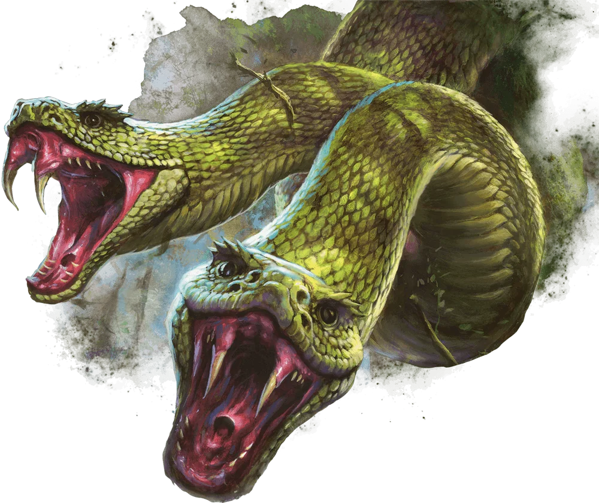
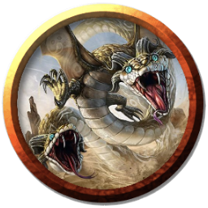

# Amphisbaena
These strange reptiles have a head at either end of their serpentine bodies, each one equipped with venomous fangs. To move, an amphisbaena uses one head to grip the neck of its other head, forming a hoop that rolls over the ground.

### Environment
Coastal, Swamp, Underwater

### Token

>### Amphisbaena
>*Medium Monstrosity, Unaligned*
>___
>- **Armor Class** 14
>- **Hit Points** 11 (2d8 + 2)
>- **Speed** 30 ft., Swim 30 ft.
>- **Initiative** +4 (14)
>___
>|STR|DEX|CON|INT|WIS|CHA|
>|:---:|:---:|:---:|:---:|:---:|:---:|
>|14 (+2)|18 (+4)|12 (+1)|3 (-4)|10 (+0)|3 (-4)|
>___
>- **Skills** Perception +2
>- **Senses** Blindsight 10 ft., Passive Perception 12
>- **Languages** —
>- **Challenge** 1/2 (XP 100; PB +2)
>- **Proficiency Bonus** +2
>___
>***Two Heads.*** The amphisbaena has advantage on Wisdom (Perception) checks and on saving throws against being blinded, charmed, deafened, frightened, stunned, and knocked unconscious.  
>
>### Actions
>***Multiattack.*** The amphisbaena makes two bite attacks.  
>
>***Bite.*** *Melee Weapon Attack:*  +6 to hit, reach 5 ft., one target. *Hit:* 6 (1d4 + 4) piercing damage, and the target must make a DC 11 Constitution saving throw, taking 3 (1d6) poison damage on a failed save, or half as much damage on a successful one.
