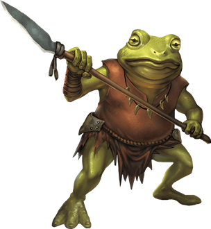
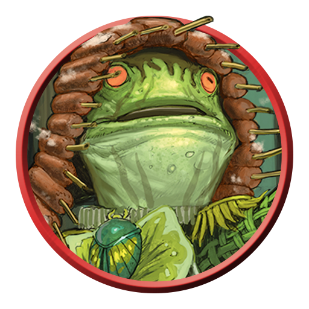
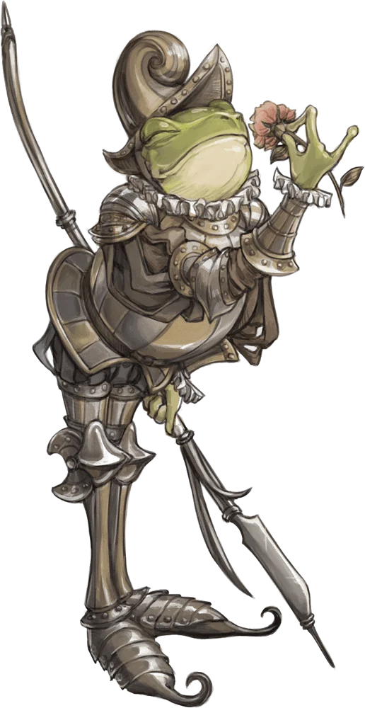
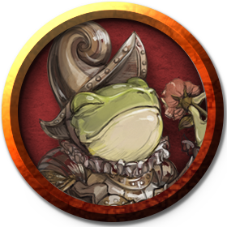
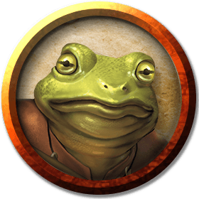
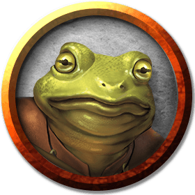

# Bullywugs
*Amphibious Appreciators of Marsh and Muck*

Fey embodiments of swamplands, bullywugs protect the murky wilds and consider themselves cosmically favored for that role. These human-size, toad- or frog-like creatures have close relationships with the creatures of the swamp.

> Jump to: [Bullywug](#bullywug) | [Bullywug Warrior](#bullywug-warrior) | [Bullywug Knight](#bullywug-knight) | [Bullywug Bog Sage](#bullywug-bog-sage) | [Bullywug Croaker](#bullywug-croaker) | [Bullywug Royal](#bullywug-royal)

Life as a bullywug is nasty, brutish, and wet. These frog-headed amphibious humanoids must stay constantly moist, dwelling in rainy forests, marshes, and damp caves. Always hungry and thoroughly evil, bullywugs overwhelm opponents with superior numbers when they can, but they flee from serious threats to search for easier prey.

Bullywugs have green, gray, or mottled yellow skin that shifts through shades of gray, green, and brown, allowing them to blend in with their surroundings. They wear crude armor and wield simple weapons, and can deliver a powerful bite to foes that press too close.

***Foul Aristocracy.*** Bullywugs consider themselves the right and proper rulers of the swamps. They follow an etiquette of sorts when dealing with outsiders and each other, subject to the whims and fancies of their leader — a self-styled lord of the muck. Bullywugs introduce themselves with grand-sounding titles, make great shows of bowing and debasing themselves before their superiors, and endlessly vie to win their superiors' favor.

A bullywug has two ways to advance among its kind. It can either murder its rivals, though it must take pains to keep its criminal deeds secret, or it can find a treasure or magic item and present it as tribute or a token of obeisance to its liege. A bullywug that murders its rivals without cunning is likely to be executed, so it's more common for bullywugs to stage raids against caravans and settlements, with the goal of securing precious baubles to impress their lords and win their good graces. Invariably, such fine goods are reduced to filthy tatters through abuse and neglect. Once a gift loses its sheen, a bullywug lord invariably demands that its subjects bring it more treasure as tribute.

***Unruly Diplomacy.*** Bullywugs love nothing more than lording over those who trespass on their territories. Their warriors attempt to capture intruders rather than simply slaying them.

Captives are dragged before the king or queen — a bullywug of unusually large size — and forced to beg for mercy. Bribes, treasure, and flattery can trick the bullywug ruler into letting its captives go, but not before it tries to impress its "guests" with the majesty of its treasure and its realm. Struck with a deep inferiority complex, bullywug lords fancy themselves as kings and queens, but desperately crave the fear and respect of outsiders.

***Amphibian Allies.*** Bullywugs speak a language that allows them to communicate over large areas by croaking like frogs. News of intruders or other events in the swamp spread within minutes across this crude communication system.

Simple concepts in the language are understandable to frogs and toads. Bullywugs use this capability to form strong bonds with giant frogs, which they train as guardians and hunters. Larger specimens are sometimes used as mounts as well. The frogs' ability to swallow creatures whole provides a bullywug hunting band an easy means of carrying prey back to their villages.

### Environment
Swamp

### Token

---

## Bullywug
Just your average frog-man.

>### Bullywug
>*Medium humanoid, neutral evil*
>___
>- **Armor Class** 15 (hide armor, shield)
>- **Hit Points** 11 (2d8 + 2)
>- **Speed** 20 ft., swim 40 ft.
>___
>|**STR**|**DEX**|**CON**|**INT**|**WIS**|**CHA**|
>|:---:|:---:|:---:|:---:|:---:|:---:|
>|12 (+1)|12 (+1)|13 (+1)|7 (-2)|10 (+0)|7 (-2)|
>
>___
>- **Proficiency Bonus** +2
>- **Saving Throws** 
>- **Damage Vulnerabilities** 
>- **Damage Resistances** 
>- **Damage Immunities** 
>- **Condition Immunities** 
>- **Skills** Stealth +3
>- **Senses** passive Perception 10
>- **Languages** Bullywug
>- **Challenge** 1/4
>___
>***Amphibious.*** The bullywug can breathe air and water.
>
>***Speak with Frogs and Toads.*** The bullywug can communicate simple concepts to frogs and toads when it speaks in Bullywug.
>
>***Swamp Camouflage.*** The bullywug has advantage on Dexterity (Stealth) checks made to hide in swampy terrain.
>
>***Standing Leap.*** The bullywug's long jump is up to 20 feet and its high jump is up to 10 feet, with or without a running start.
>
>#### Actions
>***Multiattack.*** The bullywug makes two melee attacks: one with its bite and one with its spear.
>
>***Bite.*** Melee Weapon Attack: +3 to hit, reach 5 ft., one target. Hit: 3 (1d4 + 1) bludgeoning damage.
>
>***Spear.*** Melee or Ranged Weapon Attack: +3 to hit, reach 5 ft. or range 20/60 ft., one target. Hit: 4 (1d6 + 1) piercing damage, or 5 (1d8 + 1) piercing damage if used with two hands to make a melee attack.
>

---

## Bullywug Warrior
Bullywug warriors are adept at moving through swamps and ambushing trespassers. They often work alongside packs of trained giant frogs.

### Token

___
>## Bullywug Warrior
>*Medium Fey, Neutral*
>___
>- **Armor Class** 15
>- **Hit Points** 11 (2d8 + 2)
>- **Speed** 30 ft., Swim 30 ft.
>- **Initiative** +2 (12)
>___
>|STR|DEX|CON|INT|WIS|CHA|
>|:---:|:---:|:---:|:---:|:---:|:---:|
>|12 (+1)|14 (+2)|13 (+1)|7 (-2)|10 (+0)|7 (-2)|
>___
>- **Skills** Stealth +4
>- **Senses** Passive Perception 10
>- **Languages** Bullywug, Common
>- **Challenge** 1/4 (XP 50; PB +2)
>- **Proficiency Bonus** +2
>___
>***Amphibious.*** The bullywug can breathe air and water.  
>
>***Speak with Frogs and Toads.*** The bullywug can communicate simple concepts to frogs and toads when it speaks in Bullywug.  
>
>### Actions
>***Insectile Rapier.*** *Melee Attack Roll:*  +4, reach 5 ft. *Hit:* 6 (1d8 + 2) Piercing damage plus 2 (1d4) Poison damage.  
>
>### Bonus Actions
>***Leap.*** The bullywug can jump up to 30 feet by spending 10 feet of movement.

---

## Bullywug Knight
Bullywug knights adhere to a code of chivalry. Their sense of honor compels these noble bullywugs to fight fairly and to insist that others do so as well.

### Token

>## Bullywug Knight
>*Medium Humanoid, typically Lawful Good*
>___
>- **Armor Class** 18 (*plate*)
>- **Hit Points** 66 (12d8 + 12)
>- **Speed** 30 ft., Swim 30 ft.
>- **Initiative** +1 (11)
>___
>|STR|DEX|CON|INT|WIS|CHA|
>|:---:|:---:|:---:|:---:|:---:|:---:|
>|16 (+3)|12 (+1)|13 (+1)|9 (-1)|11 (+0)|14 (+2)|
>___
>- **Saving Throws** Con +3, Wis +2
>- **Gear** *Glaive*
>- **Senses** Passive Perception 10
>- **Languages** Bullywug, Common
>- **Challenge** 3 (XP 700; PB +2)
>- **Proficiency Bonus** +2
>___
>***Amphibious.*** The knight can breathe air and water.  
>
>***Speak with Frogs and Toads.*** The knight can communicate simple concepts to frogs and toads when it speaks in Bullywug.  
>
>***Standing Leap.*** The knight's long jump is up to 20 feet and its high jump is up to 10 feet, with or without a running start.  
>
>### Actions
>***Multiattack.*** The knight makes two Glaive attacks.  
>
>***Glaive.*** *Melee Weapon Attack:*  +5 to hit, reach 10 ft., one target. *Hit:* 8 (1d10 + 3) slashing damage.  
>
>### Bonus Actions
>***Croak of Charming (Recharges after a Short or Long Rest).*** The knight makes a loud croak while targeting one creature it can see within 30 feet of it. The target must succeed on a DC 12 Wisdom saving throw or be charmed until the end of its next turn.

---

## Bullywug Bog Sage
Bullywug bog sages channel the magic of the swamp to sicken foes and speak with plants.

___
>## Bullywug Bog Sage
>*Medium Fey, Neutral*
>___
>- **Armor Class** 16
>- **Hit Points** 52 (8d8 + 16)
>- **Speed** 30 ft., Swim 30 ft.
>- **Initiative** +3 (13)
>___
>|STR|DEX|CON|INT|WIS|CHA|
>|:---:|:---:|:---:|:---:|:---:|:---:|
>|8 (-1)|16 (+3)|14 (+2)|10 (+0)|16 (+3)|12 (+1)|
>___
>- **Saving Throws** Con +4, Wis +5, Cha +3
>- **Skills** Nature +4, Stealth +5
>- **Gear** *Component Pouch*
>- **Senses** Passive Perception 13
>- **Languages** Bullywug, Common
>- **Challenge** 4 (XP 1,100; PB +2)
>- **Proficiency Bonus** +2
>___
>***Amphibious.*** The bullywug can breathe air and water.  
>
>***Speak with Frogs and Toads.*** The bullywug can communicate simple concepts to frogs and toads when it speaks in Bullywug.  
>
>### Actions
>***Multiattack.*** The bullywug makes two Bog Staff attacks. It can replace any attack with a use of Spellcasting to cast *Ray of Sickness*.  
>
>***Bog Staff.*** *Melee Attack Roll:*  +5, reach 5 ft. *Hit:* 7 (1d8 + 3) Bludgeoning damage plus 10 (3d6) Poison damage.  
>
>***Spellcasting.*** The bullywug casts one of the following spells, using Wisdom as the spellcasting ability (spell save DC 13, +5 to hit with spell attacks):  
>
>* At will: *Dancing Lights*, *Druidcraft*, *Ray of Sickness*  
>* 1/day each: *Speak with Plants*, *Vitriolic Sphere*  
>
>### Bonus Actions
>***Leap.*** The bullywug can jump up to 30 feet by spending 10 feet of movement.

---

## Bullywug Croaker
Some bullywugs are born with the ability to weave magic into their songs. These rare specimens are raised in protected enclaves where they are taught to use their magic to both heal and harm. They are among the most pompous of bullywugs.

### Token

>## Bullywug Croaker
>*Medium Humanoid (Bullywug), Neutral Evil*
>___
>- **Armor Class** 15 (*hide armor*, *shield*)
>- **Hit Points** 33 (6d8 + 6)
>- **Speed** 20 ft., Swim 40 ft.
>- **Initiative** +1 (11)
>___
>|**STR**|**DEX**|**CON**|**INT**|**WIS**|**CHA**|
>|:---:|:---:|:---:|:---:|:---:|:---:|
>|14 (+2)|12 (+1)|12 (+1)|7 (-2)|15 (+2)|10 (+0)|
>___
>- **Saving Throws** Con +3
>- **Skills** Perception +4, Stealth +3
>- **Gear** *Spear*
>- **Senses** Passive Perception 14
>- **Languages** Bullywug
>- **Challenge** 2 (XP 450; PB +2)
>- **Proficiency Bonus** +2
>___
>***Amphibious.*** The croaker can breathe air and water.  
>
>***Speak with Frogs and Toads.*** The croaker can communicate simple concepts to frogs and toads when it speaks in Bullywug.  
>
>***Standing Leap.*** The croaker's long jump is up to 20 feet and its high jump is up to 10 feet, with or without a running start.  
>
>***Swamp Camouflage.*** The croaker has advantage on Dexterity (Stealth) checks made to hide in swampy terrain.  
>
>### Actions
>***Spear.*** *Melee  or Ranged Weapon Attack:*  +4 to hit, reach 5 ft. or range 20/60 ft., one target. *Hit:* 5 (1d6 + 2) piercing damage, or 6 (1d8 + 2) piercing damage if used with two hands to make a melee attack.  
>
>***Bite.*** *Melee Weapon Attack:*  +4 to hit, reach 5 ft., one target. *Hit:* 5 (1d6 + 2) piercing damage.  
>
>***Glaaar-pat (3/Day).*** The croaker sings a song of marshy doom. Each chosen creature within 30 feet of the croaker that can hear the song must make a DC 12 Wisdom saving throw, taking 9 (2d8) psychic damage on a failed save, or half as much damage on a successful one. A creature that fails this saving throw also has disadvantage on Constitution saving throws until the end of its next turn.  
>
>***Rooooo-glog (1/Day).*** The croaker sings an ode to an elder froghemoth. Each bullywug within 30 feet of the croaker that can hear the song gains 10 temporary hit points.

---

## Bullywug Royal
The largest and most intelligent bullywugs invariably end up leading their kind. These sneering specimens dress in robes made from leather, rough cloth, and bits of marsh plants. As seen in Danger at Dunwater, a bullywug royal is often accompanied by and mounted astride a giant toad.

### Token

>### Bullywug Royal
>*Medium Humanoid (Bullywug), Neutral Evil*
>___
>- **Armor Class** 15 (*hide armor*, *shield*)
>- **Hit Points** 52 (8d8 + 16)
>- **Speed** 20 ft., Swim 40 ft.
>- **Initiative** +1 (11)
>___
>|**STR**|**DEX**|**CON**|**INT**|**WIS**|**CHA**|
>|:---:|:---:|:---:|:---:|:---:|:---:|
>|16 (+3)|12 (+1)|14 (+2)|10 (+0)|11 (+0)|14 (+2)|
>___
>- **Saving Throws** Str +5, Dex +3
>- **Skills** Athletics +5, Intimidation +4, Stealth +3
>- **Senses** Passive Perception 10
>- **Languages** Bullywug
>- **Challenge** 3 (XP 700; PB +2)
>- **Proficiency Bonus** +2
>___
>***Amphibious.*** The royal can breathe air and water.  
>
>***Brute.*** A melee weapon deals one extra die of its damage when the royal hits with it (included in the attack).  
>
>***Frog Rider.*** The royal has advantage on melee attacks made while riding a frog mount.  
>
>***Speak with Frogs and Toads.*** The royal can communicate simple concepts to frogs and toads when it speaks in Bullywug.  
>
>***Standing Leap.*** The royal's long jump is up to 20 feet and its high jump is up to 10 feet, with or without a running start.  
>
>***Swamp Camouflage.*** The royal has advantage on Dexterity (Stealth) checks made to hide in swampy terrain.  
>
>### Actions
>***Multiattack.*** The royal makes two attacks: one with its royal spear and one with its bite.  
>
>***Royal Spear.*** *Melee  or Ranged Weapon Attack:*  +5 to hit, reach 10 ft. or range 20/60 ft., one target. *Hit:* 10 (2d6 + 3) piercing damage, or 12 (2d8 + 3) piercing damage if used with two hands to make a melee attack. If the target is a Medium or smaller creature, it must succeed on a DC 13 Strength saving throw or be knocked prone.  
>
>***Bite.*** *Melee Weapon Attack:*  +5 to hit, reach 5 ft., one target. *Hit:* 6 (1d6 + 3) piercing damage.  
>
>***Croaked Decree (1/Day).*** The royal makes a loud pronouncement. Each bullywug within 60 feet of the royal that can hear the pronouncement has advantage on its next attack roll.
