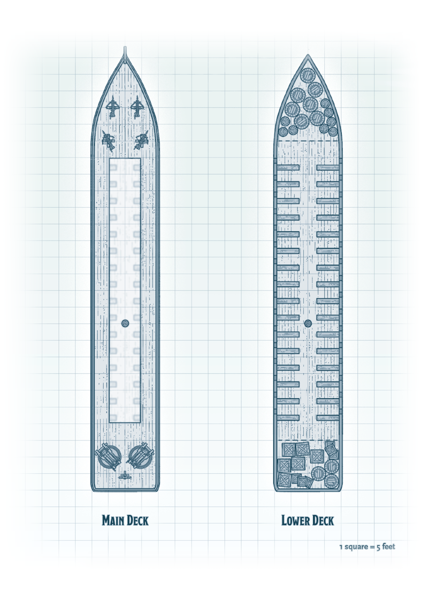
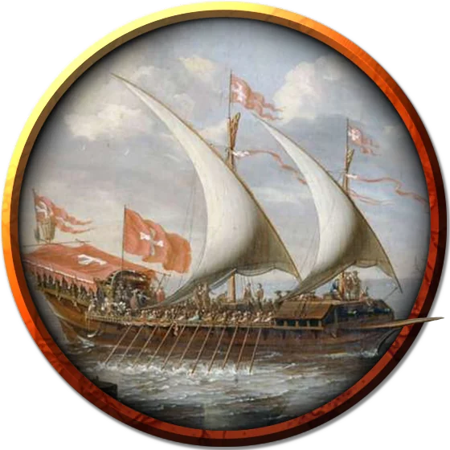

# Galley
Galleys are long vessels that rely on sails and sizable rowing crews to move. These ships can carry siege weapons and soldiers to war or transport large amounts of cargo for merchants. No matter the ship's purpose, the crew almost always hires extra protection, since galleys make large, cargo-rich targets for pirates.

A galley has the following features:

- **Ceilings.** The ceiling of the galley's lower deck is 8 feet high.
- **Light.** Hanging lanterns cast bright light throughout the ship.
- **Rigging.** Rigging on the ship can be climbed without an ability check.
- **Sails and Oars.** The galley has one 120-foot-tall mast with sails to catch the wind and oars on the lower deck for rowing the vessel.

#### Example Galley Crew

A galley requires a crew of eighty to properly sail or row the vessel and might carry extra passengers or soldiers. If the characters are guests on a galley, the crew consists of the following creatures, all of which have proficiency with water vehicles in addition to their normal statistics:

- One captain (**bandit captain**)
- Five other officers: a first mate, a bosun, a quartermaster, a surgeon, and a cook (**scouts**)
- Forty-two sailors (**commoners**)
- Twelve siege engineers (**guards**)
- Twenty **guards**

#### Main Deck
The main deck of the galley has the following features:

- **Ballistas.** Four ballistas (DMG, ch. 8) are attached to the fore of the deck. Ten ballista arrows are stacked and secured near each.
- **Mangonels.** Two mangonels (DMG, ch. 8) are attached to the aft of the deck. Ten mangonel stones are stacked and secured near each catapult.
- **Naval Ram.** The galley's stern features an iron naval ram used for attacking other ships.
- **Opening.** A 10-foot-wide, 80-foot-long open space in the middle of the deck stretches fore to aft and leads down to the lower deck.
- **Railing.** A 3-foot-high rail is built around the deck's perimeter, providing half cover for Medium creatures and three-quarters cover for Small creatures behind it.
- **Rowboats.** Eight rowboats are stacked in two groups of four on this deck. Ropes and pulleys can hoist these boats in and out of the water.
- **Timpani.** A timpani with two attached mallets sits on the aft of the main deck just before the opening to the lower deck. A crew member plays this instrument while the sailors on the lower deck row, the beat helping to synchronize the rowers' strokes.
- **Wheel.** The ship's wheel stands at the aft of the deck.

#### Lower Deck

The cramped lower deck of the galley ship reeks of body odor and has the following features:

- **Cargo Holds.** Cargo holds at the fore and aft of the lower deck hold crates, barrels, and ammunition secured with rope.
- **Oars.** Thirty-two benches are built into the deck, each with a 20-foot-long oar. When the ship is rowed, crew members sit on these benches to work the oars. Ten spare oars hang on the walls.

### Token

>### Galley
>*Gargantuan vehicle (sea; 130 ft. by 20 ft.)*
>___
>- **Creature Capacity** 20 minimum/80 optimum crew, 40 passengers
>- **Cargo Capacity** 150 tons
>- **Travel Pace** 4 miles per hour (96 miles per day)
>- **Speed** 40 ft.
>___
>|**STR**|**DEX**|**CON**|**INT**|**WIS**|**CHA**|
>|:---:|:---:|:---:|:---:|:---:|:---:|
>|24 (+7)|4 (-3)|20 (+5)|0 (-5)|0 (-5)|0 (-5)|
>___
>- **Damage Immunities** poison, psychic
>- **Condition Immunities** blinded, charmed, deafened, exhaustion, frightened, incapacitated, paralyzed, petrified, poisoned, prone, stunned, unconscious
>___
>#### Actions
>On its turn, the galley can take 3 actions, choosing from the options below. It can take only 2 actions if it has fewer than forty crew and only 1 action if it has fewer than twenty. It can't take these actions if it has fewer than three crew.
>
>**Fire Ballistas.** The galley can fire its ballistas.
>**Fire Mangonels.** The galley can fire its mangonels.
>**Move.** The galley can use its helm to move with its oars or sails. As part of this move, it can use its naval ram.
>
>#### Hull
>- **Armor Class** 15
>- **Hit Points** 500 (damage threshold 20)
>
>#### Control: Helm
>- **Armor Class** 16
>- **Hit Points** 50
>
>Move up to the speed of one of its movement components, with one 90-degree turn. If the helm is destroyed, the galley can't turn.
>
>#### Movement: Oars
>- **Armor Class** 12
>- **Hit Points** 100; -5 ft. speed per 25 damage taken
>- **Speed (water).** 30 ft. (requires at least 40 crew)
>
>#### Movement: Sails
>- **Armor Class** 12
>- **Hit Points** 100; -10 ft. speed per 25 damage taken
>- **Speed (water).** 35 ft.; 15 ft. while sailing into the wind; 50 ft. while sailing with the wind
>
>### Weapons: Ballistas (4)
>- **Armor Class** 15
>- **Hit Points** 50 each
>
>- *Ranged Weapon Attack:*  +6 to hit, range 120/480 ft., one target. *Hit:* 16 (3d10) piercing damage.
>
>### Weapons: Mangonels (2)
>- **Armor Class** 15
>- **Hit Points** 100 each
>- *Ranged Weapon Attack:*  +5 to hit, range 200/800 ft. (can't hit targets within 60 ft. of it), one target. *Hit:* 27 (5d10) bludgeoning damage.
>
>### Weapons: Naval Ram
>- **Armor Class** 20
>- **Hit Points** 100 (damage threshold 10)
>
>The galley has advantage on all saving throws relating to crashing when it crashes into a creature or an object. Any damage it takes from the crash is applied to the naval ram rather than to the ship. These benefits don't apply if another vessel crashes into the galley.
