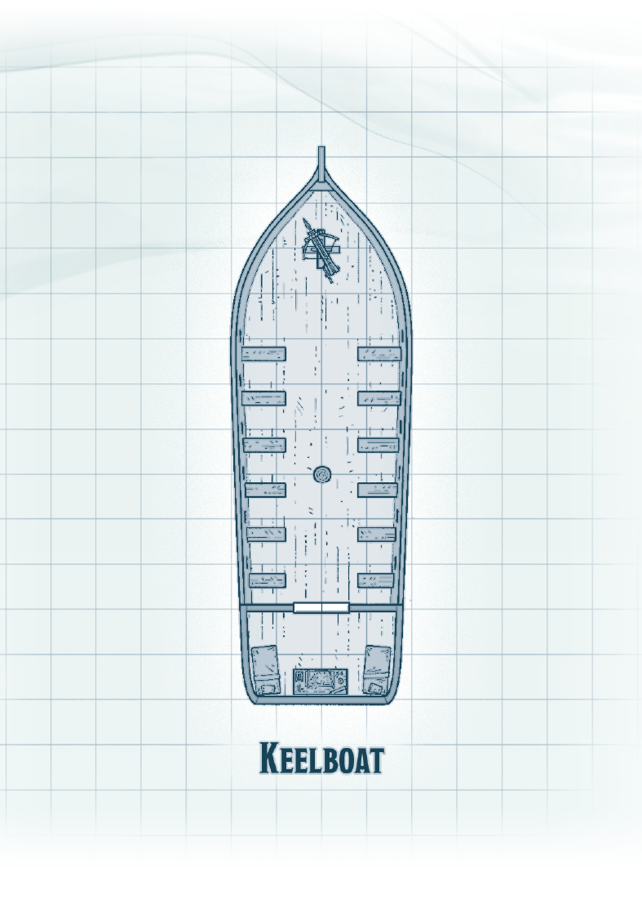
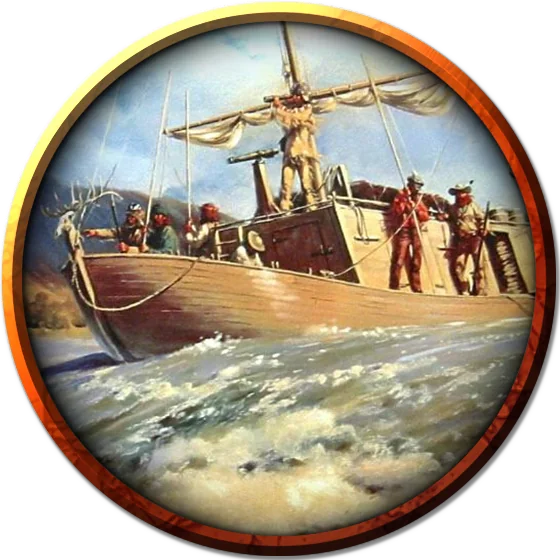

# Keelboat
One of the smallest sailing vessels, keelboats can be sailed or rowed by a single person. These ships often transport small amounts of cargo or passengers. They're perfect for pleasure cruises, as they're easier and less expensive to operate than larger vessels.

A keelboat has the following features:

- **Light.** A hanging lantern or two casts bright light across the ship.
- **Rigging.** Rigging on the ship can be climbed without an ability check.
- **Sails.** The keelboat has one 10-foot-tall mast with sails.

### Example Keelboat Crew
A keelboat requires a single crew member to operate smoothly. If the characters are guests on a keelboat, the crew consists of a single captain who has the statistics of a bandit captain with proficiency with water vehicles.

#### Keelboat Deck
The deck of the keelboat has the following features:

- **Weapon.** A keelboat typically has space for a Large-sized siege weapon, typically a [Ballista](../Siege/Ballista.md) or [Mangonel](../Siege/Mangonel.md). Such boats typically have a small (10 or so shots) supply of ammunition stored nearby for easy reach during combat, and sometimes more in storage.
- **Oars.** The deck of the ship holds twelve benches and four 15-foot-long oars. When the ship is rowed, crew members sit on these benches to work the oars.
- **Railing.** The deck has a 3-foot-high rail around its perimeter that provides half cover for Medium creatures and three-quarters cover for Small creatures behind it.

#### Keelboat Cabin
The keelboat cabin has the following features:

- **Footlockers.** Beneath each bed is a footlocker. The footlockers are iron and have AC 19, 18 hit points, and immunity to poison and psychic damage.
- **Furnishings.** Two beds and a desk with a chair stand at the aft of the cabin.

### Token

>### Keelboat
>*Gargantuan Vehicle (60 ft. by 20 ft.)*
>___
>- **Creature Capacity** 1 minimum/3 optimum crew, 4 passengers
>- **Cargo Capacity** 0.5 tons
>- **Travel Pace** 3 miles per hour (72 miles per day)
>___
>|**STR**|**DEX**|**CON**|**INT**|**WIS**|**CHA**|
>|:---:|:---:|:---:|:---:|:---:|:---:|
>|16 (+3)|7 (-2)|13 (+1)| 0 | 0 | 0 |
>
>___
>- **Damage Immunities** poison, psychic
>- **Condition Immunities** blinded, charmed, deafened, exhaustion, frightened, incapacitated, paralyzed, petrified, poisoned, prone, stunned, unconscious
>___
>#### Actions
>On its turn, the keelboat can take 2 actions, choosing from the options below. It can take only 1 action if it has only one crew. It can't take these actions if it has no crew.
>
>**Fire Ballistas.** The keelboat can fire its ballistas (DMG, ch. 8).
>
>**Move.** The keelboat can use its helm to move with its oars or sails.
>
>#### Hull
>- **Armor Class** 15
>- **Hit Points** 100 (damage threshold 10)
>
>#### Control: Helm
>- **Armor Class** 12
>- **Hit Points** 50
>
>Move up to the speed of one of the ship's movement components, with one 90-degree turn. If the helm is destroyed, the keelboat can't turn.
>
>#### Movement: Oars
>- **Armor Class** 12
>- **Hit Points** 100; -5ft speed per 20 damage taken
>- **Speed (water)** 20 ft.
>
>#### Movement: Sails
>- **Armor Class** 12
>- **Hit Points** 50; -5ft speed per 20 damage taken
>- **Speed (water)** 25 ft.; 15 ft. while sialing into the wind; 35 ft. while sailing with the wind
>
>#### Weapons: Ballista
>- **Armor Class** 15
>- **Hit Points** 50
>- *Ranged Weapon Attack:* +6 to hit, range 120/480 ft., one target. *Hit:* 16 (3d10) piercing damage.
>
>Keelboats typically include a ballista only when they are equipped for combat.

>

