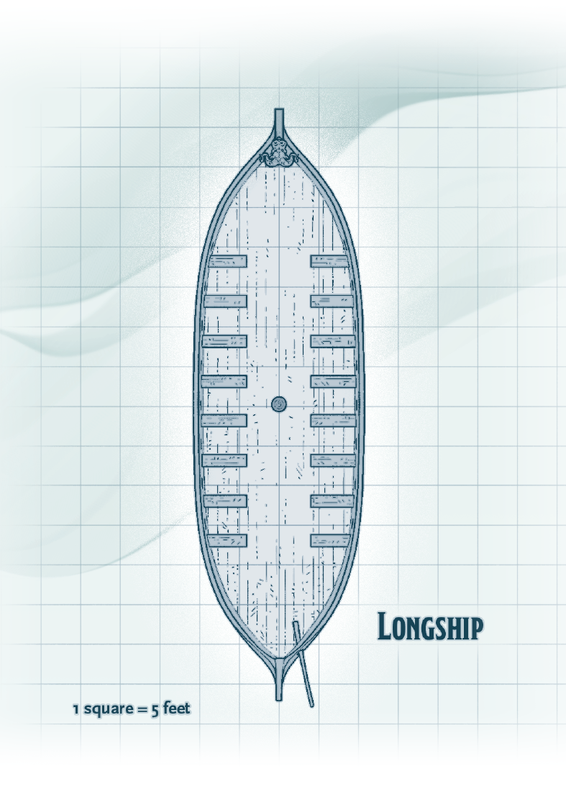
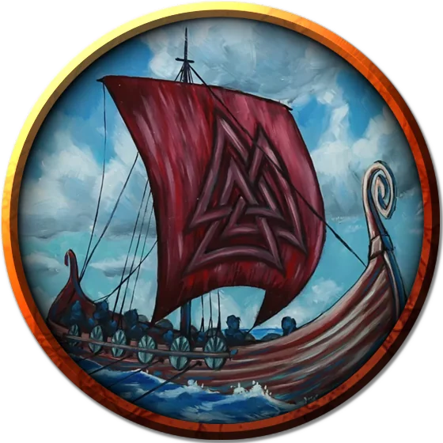

# Longship
Longships are vessels that rely on a rowing crew and sails to move across the sea. These ships are typically used to carry soldiers into combat. The size of a longship makes it easy for troops to get on and off quickly, making it the perfect ship for engaging in surprise strikes.

A longship has the following features:

- **Light.** Hanging lanterns cast bright light over the deck.
- **Rigging.** Rigging on the ship can be climbed without an ability check.
- **Rudder.** The ship is steered by a rudder control on the aft of the deck.
- **Sails.** The longship has one 20-foot-tall mast with sails that can be used to sail the ship.

#### Example Longship Crew

A longship requires a crew of forty to properly sail or row the vessel and often carries extra passengers or soldiers. If the characters are guests on a longship, the crew consists of the following creatures, all of which have proficiency with water vehicles in addition to their normal statistics:

- One captain (**berserker**)
- Five other officers: a first mate, a bosun, a quartermaster, a surgeon, and a cook (**berserkers**)
- Thirty-four sailors (**commoners**)

#### Longship Deck

The deck of the longship has the following features:

- **Oars.** Sixteen benches are built into the deck, each with a 15-foot-long oar. When the ship is rowed, crew members sit on these benches to work the oars. Five spare oars hang on the walls.
- **Railing.** The deck has a 3-foot-high rail covered in wooden shields around its perimeter that provides half cover for Medium creatures and three-quarters cover for Small creatures behind it.

### Token

>### Longship
>*Gargantuan vehicle (sea; 70 ft. by 20 ft.)*
>___
>- **Creature Capacity** 10 minimum/40 optimum crew, 100 passengers
>- **Cargo Capacity** 10 tons
>- **Travel Pace** 5 miles per hour (120 miles per day)
>- **Speed** 50 ft.
>___
>|**STR**|**DEX**|**CON**|**INT**|**WIS**|**CHA**|
>|:---:|:---:|:---:|:---:|:---:|:---:|
>|20 (+5)|6 (-2)|17 (+3)|0 (-5)|0 (-5)|0 (-5)|
>___
>- **Damage Immunities** poison, psychic
>- **Condition Immunities** blinded, charmed, deafened, exhaustion, frightened, incapacitated, paralyzed, petrified, poisoned, prone, stunned, unconscious
>___
>#### Actions
>On its turn, the longship can take the move action below. It can't take this action if it has no crew.
>
>**Move.** The longship can use its helm to move with its oars or sails.
>
>#### Hull
>- **Armor Class** 15
>- **Hit Points** 300 (damage threshold 15)
>
>#### Control: Helm
>- **Armor Class** 16
>- **Hit Points** 50
>
>Move up to the speed of one of its movement components, with one 90-degree turn. If the helm is destroyed, the longship can't turn.
>
>#### Movement: Oars
>- **Armor Class** 12
>- **Hit Points** 100; -5 ft. speed per 25 damage taken
>- **Speed (water).** 20 ft. (requires at least 20 crew)
>
>#### Movement: Sails
>- **Armor Class** 12
>- **Hit Points** 100; -10 ft. speed per 25 damage taken
>- **Speed (water).** 45 ft.; 15 ft. while sailing into the wind; 60 ft. while sailing with the wind.
>
