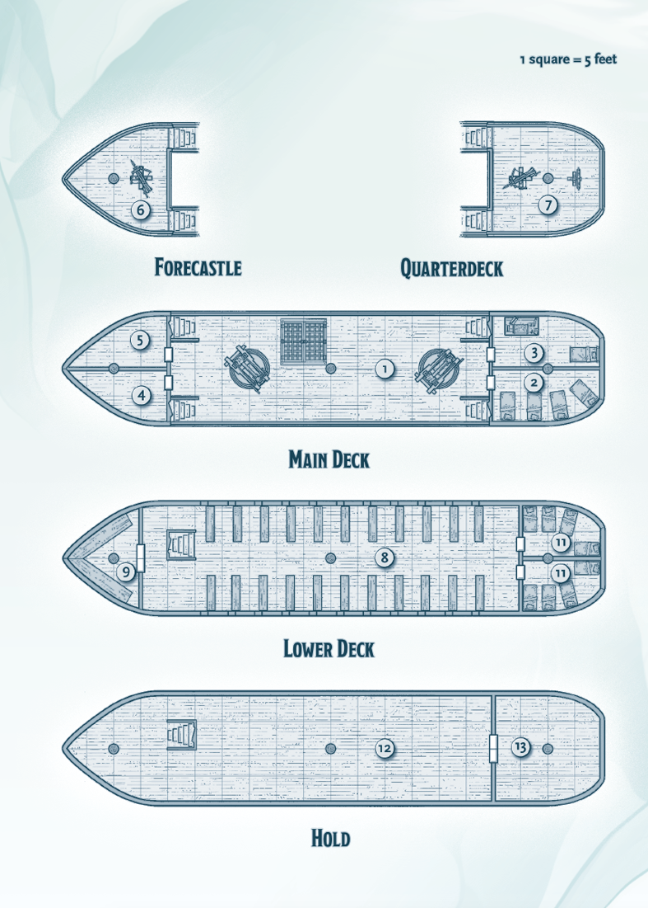
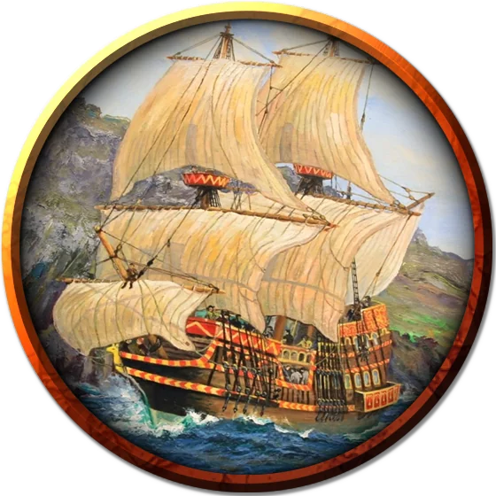

# Warship
Warships are slow, heavily armed vessels capable of taking on large amounts of cargo.

A warship ship has the following features:

- **Ceilings.** The ceilings in the lower deck, holds, and cabins are 8 feet high with 6-foot-high doorways.
- **Doors.** The ship's doors are made of wood and have AC 15, 18 hit points, and immunity to poison and psychic damage. A lock can be picked with a successful DC 15 Dexterity check made using thieves' tools, or the door can be forced open with a successful DC 20 Strength (Athletics) check.
- **Footlockers.** Footlockers on the ship are iron and have AC 19, 18 hit points, and immunity to poison and psychic damage.
- **Light.** Hanging lanterns cast bright light throughout the ship.
- **Rigging.** Rigging on the ship can be climbed without an ability check.
- **Sails.** The ship has three 80-foot-tall masts with sails to catch the wind and oars on the lower deck for rowing.

#### Example Crew
A warship requires a large crew to properly sail the vessel. Warships carry extra soldiers to fight battles and fire the siege weapons. If the characters are guests on a warship, the crew consists of the following creatures, all of which have proficiency with water vehicles in addition to their normal statistics:

- One captain (**bandit captain**)
- Four other officers: a first mate, a bosun, a quartermaster, and a cook (**nobles**)
- Twenty-five sailors (**commoners**)

A warship typically includes the following additional crew to augment its fighting ability:

- Forty soldiers (**guards**)
- Eight siege engineers (**guards**)
- One **priest** (the ship's surgeon)

#### 1. Main Deck
The main deck of the ship has the following features:

- **Mangonel.** Warships have two mangonels (DMG, ch. 8). Each weapon has 10 mangonel stones stacked and secured near it.
- **Hatch.** A covered, 10-foot-square opening leads to the lower deck (area W8).
- **Railing.** The main deck has a 3-foot-high rail around its perimeter that provides half cover for Medium creatures and three-quarters cover for Small creatures behind it.
- **Rowboats.** Four rowboats are stacked on top of each other on this deck. Ropes and pulleys can hoist these boats in and out of the water.

#### 2. Officers' Quarters
Four beds stand in the officer's quarters. Beneath each is an iron footlocker that holds the officers' belongings. The officers sleep in shifts so someone remains on duty to command the crew and carry out the captain's orders.

#### 3. Captain's Quarters
The captain's quarters hold a bed and a desk. Beneath the bed is an iron footlocker that holds the captain's belongings.

#### 4. Siege Weapon Ammunition
Shelves and rope on the walls of this cabin secure mangonel stones and ballista arrows.

#### 5. Supplies
This area holds tools, barrels of tar, rope, extra material to repair sails, and other supplies needed to maintain the ship.

#### 6. Forecastle
The forecastle has the following features:

- **Ballista.** A ballista (DMG, ch. 8) is attached to the deck. Ten ballista arrows are stacked and secured nearby.
- **Figurehead.** Warships have an iron figurehead at the front of their forecastle, often shaped to look like a fearsome sea predator. This figurehead serves as the ship's naval ram.
- **Railing.** The forecastle has a 3-foot-high rail around its perimeter that provides half cover for Medium creatures and three-quarters cover for Small creatures behind it.

#### 7. Quarterdeck
The quarterdeck has the following features:

- **Ballista.** On a warship, a ballista (DMG, ch. 8) is attached to the deck. Ten ballista arrows are stacked and secured nearby.
- **Railing.** The quarterdeck has a 3-foot-high rail around its perimeter that provides half cover for Medium creatures and three-quarters cover for Small creatures behind it.
- **Wheel.** The ship's wheel stands at the aft of the quarterdeck.

#### 8. Oar Deck
Twenty-two benches are built into the deck of the lower deck, each with a 20-foot-long oar. When the ship is rowed, crew members sit on these benches to work the oars. Ten spare oars hang on the walls of the ship.

#### 9. Privy
Benches line the walls of this room. Four holes carved in them house chamber pots.

#### 10. Medical Cabin
Hooks and shelves on the walls hold medical instruments, bandages, balms, tonics, jars of leeches, and more, ready to treat injuries from combat or sailing mishaps.

#### 11. Brig
This cabin is meant for guests and visiting high-ranking officials along for the journey. Since warships often have a greater need to house prisoners rather than guests, each bed aboard such a vessel also has a set of *manacles* attached to its frame.

#### 12. Hold
This area houses both passengers and cargo. The ship's off-duty crew sleep on bedrolls among the crates and barrels of food, water, and other supplies.

#### 13. Armory
The ship's supply of weapons and armor is held in this cabin. Its walls are fitted with built-in weapon and armor racks. The door to this cabin is usually locked, the key kept by one of the ship's officers.

### Token

>### Warship
>*Gargantuan vehicle (sea; 100 ft. by 20 ft.)*
>___
>- **Creature Capacity** 10 minimum/40 optimum crew, 60 passengers
>- **Cargo Capacity** 200 tons
>- **Travel Pace** 4 miles per hour (96 miles per day)
>- **Speed** 40 ft.
>___
>|**STR**|**DEX**|**CON**|**INT**|**WIS**|**CHA**|
>|:---:|:---:|:---:|:---:|:---:|:---:|
>|20 (+5)|4 (-3)|20 (+5)|0 (-5)|0 (-5)|0 (-5)|
>___
>- **Damage Immunities** poison, psychic
>- **Condition Immunities** blinded, charmed, deafened, exhaustion, frightened, incapacitated, paralyzed, petrified, poisoned, prone, stunned, unconscious
>___
>#### Actions
>On its turn, the warship can take 3 actions, choosing from the options below. It can take only 2 actions if it has fewer than twenty crew and only 1 action if it has fewer than ten. It can't take these actions if it has fewer than three crew.
>
>- **Fire Ballista.** The ship can fire its ballistas.
>- **Fire Mangonel.** The ship can fire its mangonels.
>- **Move.** The ship can use its helm to move with its sails. As part of this move, it can use its naval ram.
>
>#### Hull
>- **Armor Class** 15
>- **Hit Points** 500 (damage threshold 20)
>
>#### Control: Helm
>- **Armor Class** 18
>- **Hit Points** 50
>
>Move up to the speed of its movement components, with one 90-degree turn. If the helm is destroyed, the warship can't turn.
>
>#### Movement: Oars
>- **Armor Class** 12
>- **Hit Points** 100; -5 ft. speed per 25 damage taken
>- **Speed (water).** 20 ft. (requires at least 20 crew)
>
>#### Movement: Sails
>- **Armor Class** 12
>- **Hit Points** 100; -10 ft. speed per 25 damage taken
>- **Speed (water).** 35 ft.; 15 ft. while sailing into the wind; 50 ft. while sailing with the wind.
>
>#### Weapons: Ballistas (2)
>- **Armor Class** 15
>- **Hit Points** 50 each
>- *Ranged Weapon Attack:*  +6 to hit, range 120/480 ft., one target. *Hit:* 16 (3d10) piercing damage.
>
>#### Weapons: Mangonels (2)
>- **Armor Class** 15
>- **Hit Points** 100 each
>- *Ranged Weapon Attack:*  +5 to hit, range 200/800 ft. (can't hit targets within 60 ft. of it), one target. *Hit:* 27 (5d10) bludgeoning damage.
>
>#### Weapons: Naval Ram
>- **Armor Class** 20
>- **Hit Points** 100 (damage threshold 10)
>
>The warship has advantage on all saving throws relating to crashing when it crashes into a creature or object. Any damage it takes from the crash is applied to the naval ram rather than to the ship. These benefits don't apply if another vessel crashes into the warship.
